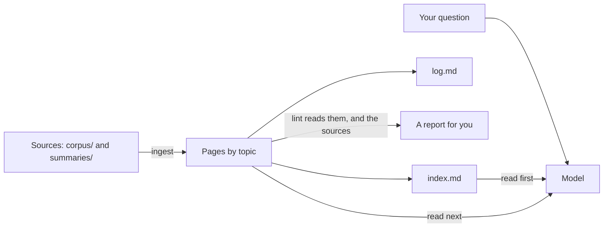
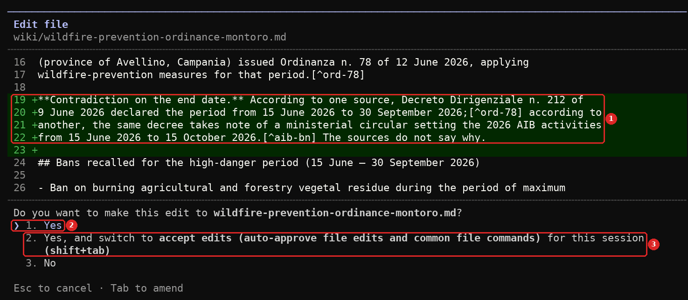
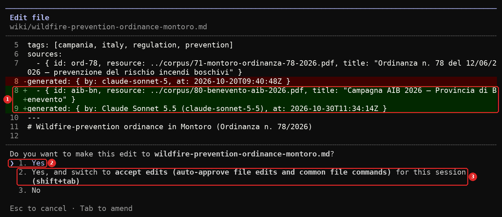
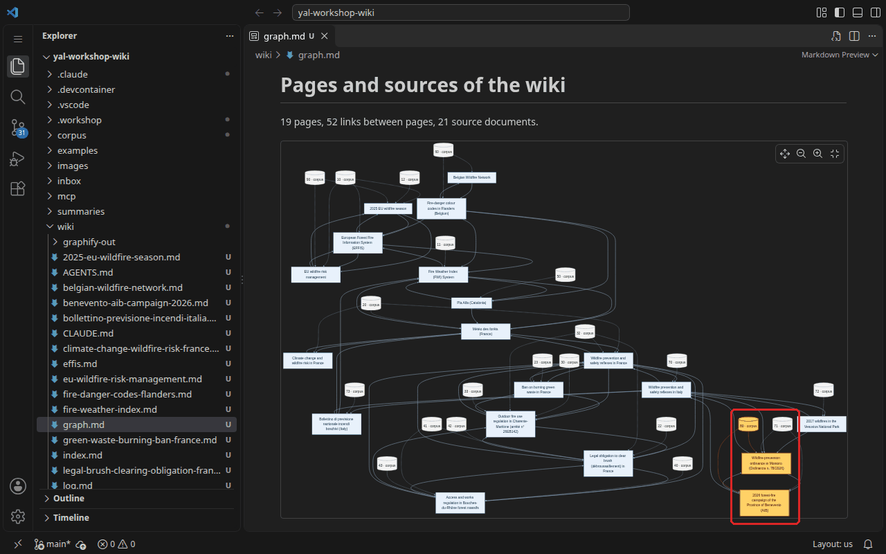
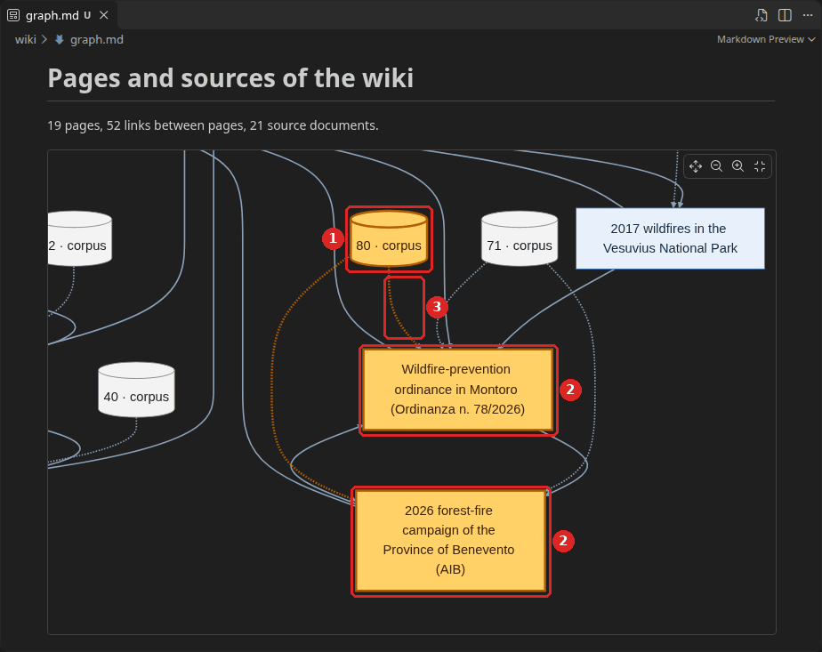
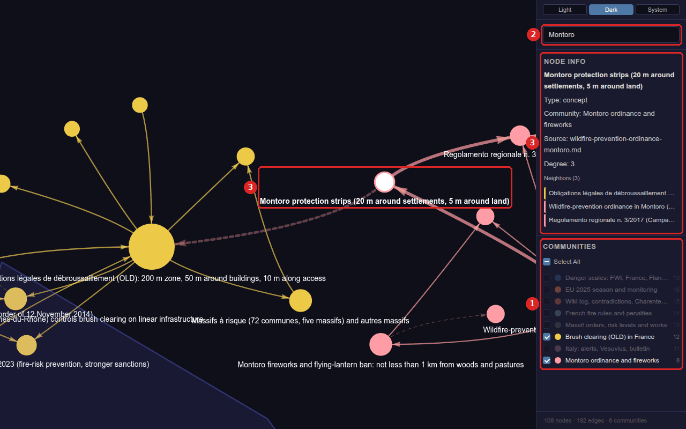
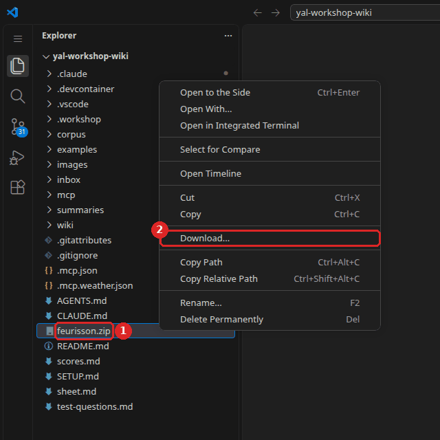
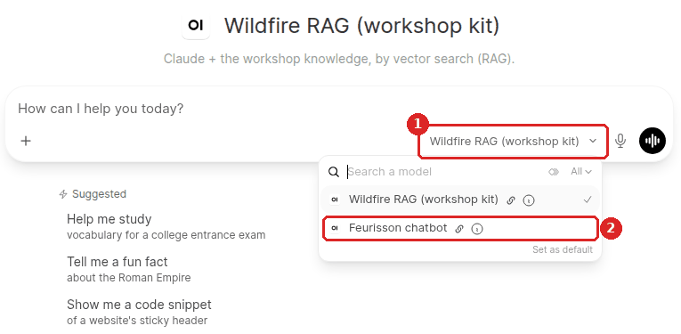
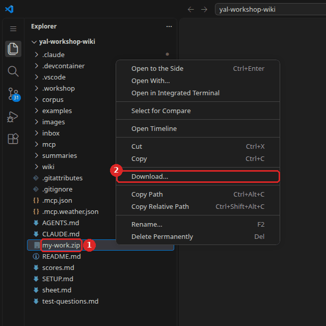

# Workshop 5 - Organise what it knows

### Youth AI Lab (Erasmus+) - series "Build your own chatbot", workshop 5 of 6

- **Project:** Youth AI Lab (Erasmus+), with five partners: L.A.B. (Aix-en-Provence, France),
  UAB (Barcelona, Spain), Perlatecnica (Naples, Italy), Digitale Wolven (Antwerp, Belgium),
  CSC Vent des Îles (La Rochelle, France).
- **The series:** [the six workshops](https://github.com/Youth-AI-Lab/yal-workshop-kit#the-series)
- **Need help?**
  - Raise your hand and ask the facilitator.
  - If something breaks, don't panic: your files stay in the Codespace.

> 🎓 **Open your Codespace** (one per pair): 👉 **https://codespaces.new/Youth-AI-Lab/yal-workshop-wiki**
>
> **Before you click**, if the idle timeout of this GitHub account is not set yet: do
> [step 1 of SETUP.md](SETUP.md#step-1---let-the-codespace-wait-for-you) (1 minute).
>
> This link creates your own copy of this repository, in VS Code running in your browser. Nothing
> to install. The detailed steps are in [Part 1](#part-1---welcome-20-min).

> 📚 **The slides of the facilitator:** https://youth-ai-lab.github.io/yal-workshop/5/ (the same
> words as this page). **The short version** of this page, on one page: [sheet.md](sheet.md). The
> setup, the commands and the common problems of the whole series: [SETUP.md](SETUP.md).

### Contents

- [Goals of the session](#goals-of-the-session)
- [Part 1 - Welcome (20 min)](#part-1---welcome-20-min)
- [Part 2 - The wiki (★★★, 30 min)](#part-2---the-wiki--30-min)
- [Part 3 - The lint (★★, 15 min)](#part-3---the-lint--15-min)
- [Part 4 - The graph (★★, 25 min)](#part-4---the-graph--25-min)
- [Part 5 - The chatbot you built (20 min)](#part-5---the-chatbot-you-built-20-min)
- [Troubleshooting](#troubleshooting)

---

## Goals of the session

### What you will be able to do by the end of this session

In workshop 3, the model searched the documents again at every question, and it kept nothing of
what it found. Today, the work is done **before** the question: the model writes pages, a person
decides what to keep, and the chatbot reads what is already organised. Then you pack everything you
built into one file. The question of the day is:

> **How do you keep knowledge clean when it grows?**

| Bloom level | Parts | You will be able to... | Mode |
|---|---|---|---|
| **Understand** | 2 | Explain what a wiki written by a model is: pages by topic, a footnote on each fact, a log, and why it keeps two figures that disagree. | `E` |
| **Apply** | 2 | Add your own document to the wiki with `ingest`, and see which pages it feeds. | `E` |
| **Analyse** | 3 | Read a lint report, and decide what to apply. | `E` |
| **Evaluate** | 4 | Check a connection guessed by a model against the sources, and say whether it holds. | terminal |
| **Create** | 5 | Pack the chatbot of your territory, and say what you would change before a group uses it. | terminal |

You go on testing your chatbot: today, column **E**, with questions 3, 10, 11 and 12.

### Why this approach?

Mode B read everything, every time. The RAG received pieces chosen by a search engine. Mode C
searched, and started from zero at the next question. So every question paid for the same work
again. A **wiki** does this work once, in advance. It is a set of pages, one page per **topic** (a
rule, a place, an organisation), linked together, and each fact ends with a **footnote**, a mark
that leads to its source.

This has a price: pages go out of date, and they can drift away from their sources. So **the model
maintains the pages, and a person decides.** The wiki keeps a history, the **log**. The model can
check the whole wiki with a **lint**, which reports problems and fixes nothing by itself. And when a
model guesses a link between two ideas, a person goes to the sources and looks.

### How this connects to WikiYouthBot

In the WikiYouthBot activity, the chatbot is built in a tool with **two boxes**: *Instructions* and
*Knowledge*. You can already do it today with Open WebUI: see the
[Open WebUI guide, What a chatbot is made of](https://github.com/Youth-AI-Lab/yal-openwebui-guide#what-a-chatbot-is-made-of).
Part 2 gives clean pages for the *Knowledge* box, and Part 5 puts everything back in the two boxes.
The activity sheet is a PDF:
[WikiYouthBot ideation sheet](https://github.com/Youth-AI-Lab/deliverables/blob/master/Ideation_Sheets/YouthAiLab_Template_Explorations_Ideation_Sheet_WikiYouthBot.pdf).
What young people built with it in La Rochelle, in July 2026, is on
[the WikiYouthBot site](https://youth-ai-lab.github.io/wikiyouthbot/).

The whole series, one piece of the chatbot at a time:

- **Workshop 1**: the instructions, and how to test a chatbot
- **Workshop 2**: all the knowledge in the context, then a RAG
- **Workshop 3**: the model searches by itself, and skills
- **Workshop 4**: tools that act outside, such as today's fire danger level
- **Workshop 5** (this one): organise what it knows in a wiki, and pack the chatbot of your territory
- **Workshop 6**: fine-tune a small model, to sort messages before the chatbot

### Before you start

**Bring `my-work.zip`**, the file you saved at the end of the last workshop. Without it, you work
with the example chatbot (Feurisson) and the document of Benevento, and you still see everything.
More in [SETUP.md, Before you start](SETUP.md#before-you-start).

### Reference documents

All of these are in your Codespace, in the file list on the left, once Part 1 is done:

- `wiki/index.md` and `wiki/log.md`: the list of the pages, and the history of the wiki.
- `wiki/AGENTS.md`: the **schema**, the rules the model follows when it writes in the wiki.
- `.claude/skills/ingest/` and `.claude/skills/lint/`: the two skills of today.
- `test-questions.md` and `scores.md`: the test set and your score sheet.

---

## Part 1 - Welcome (20 min)

**Goal**: open the Codespace, bring back your work, and start Open WebUI for Part 5.

### Step 1 - Open your Codespace and save your key

Follow [SETUP.md](SETUP.md#setup), steps 1 to 5, with the link at the top of this page: let the
Codespace wait for you, open it, save your key with `workshop-login`, check `Key OK`, have a first
conversation with `workshop bare`, and open a second terminal. In a new Codespace, the first
`workshop E` asks once more whether you trust the folder: press the **down arrow** to choose
`Yes, I trust this folder`, then **Enter**. If Claude Code closed, type `workshop E` again.

> 💡 **If you use OpenCode.** Same commands, after `workshop-login --engine opencode`. It asks you
> before every shell command and every file it writes, so `ingest` means more "allow" answers.
> `wiki-graph`, `wiki-explore` and `chatbot-export` use no model. We have not measured `ingest` and
> `lint` with OpenCode yet: TO BE COMPLETED. The same pieces, in a chatbot folder:
> [OpenCode guide, Part 4 - The knowledge](https://github.com/Youth-AI-Lab/yal-opencode-guide#part-4---the-knowledge).

> 💡 **If your key starts with `sk-or-` (OpenRouter).** Paste it in `workshop-login`, with no option:
> the key chooses OpenCode, and `score` and Open WebUI use OpenRouter too. `openwebui chatbot`, and
> Open WebUI with the default model, DeepSeek V4 Flash: (not tested). Compare your own columns only:
> `score` writes the model under the table, and warns when two columns used different models. The
> chatbot figures of this page (cost, time, gauge, scores) were measured with Claude, not with this
> model.

> ℹ️ **No Codespace?** The same repository opens on your own computer, with Docker and VS Code: see
> the [dev containers guide, Part 3](https://github.com/Youth-AI-Lab/yal-devcontainer-guide#part-3---open-a-repository).

### Step 2 - Bring back your work

1. **Drag `my-work.zip`** from your computer into the file list of the Codespace. If you
   downloaded it more than once, your browser may have named the newest one `my-work (1).zip`:
   drag that one, and type its exact name between quotes, for example
   `workshop-start 5 --from "my-work (1).zip"`.
2. In your first terminal, type:

   ```bash
   workshop-start 5 --from my-work.zip
   ```

   Without a save, type `workshop-start 5`. With a save, you should see `Restored from my-work.zip
   (saved on …)`: check that this date is the end of workshop 4. If it is older, this is an old save:
   tell the facilitator. Then you see your files restored, and:

   ```
   Prepared for this workshop:
     - The wiki is ready (wiki-start): wiki/, and the skills ingest and lint.

   Ready for workshop 5.
   ```

   Without a save, the "Prepared" list also says that `AGENTS.md` is now a copy of the Feurisson
   example, and that the document of Benevento is in `corpus/`: an official document, with no
   summary and no signature.

### Step 3 - Start Open WebUI in the background

In Part 5, you will see your finished chatbot in Open WebUI. Its first start takes a few
minutes (3 min 21 in a Codespace on 2026-10-26, older image): start it now.

1. In your second terminal, type:

   ```bash
   openwebui start
   ```

2. Do not wait for it: go on with Part 2 in your first terminal. It is done when you see
   `Open WebUI is ready, …`.

> 🚫 **Warning.** **Never make port 3000 public** (Ports tab, Port Visibility). This Open WebUI has
> no accounts: anyone with the link could use your key.

> 💡 **Tip.** **Checkpoint**: `Key OK`, `Ready for workshop 5`, and `openwebui start` running in the
> second terminal.

---

## Part 2 - The wiki (★★★, 30 min)

**Goal**: read the wiki, add your own document to it, and see which pages it feeds.

The facilitator prepared this wiki before the session: a model wrote it from all the documents of
`corpus/`, except the one of Benevento, then the wiki went through a lint and corrections.

### What you will discover

- **Footnotes**: every fact of a page leads back to its source document.
- **The log**: the history of the wiki. It lists the **contradictions**: two sources that give
  different figures for the same thing, or a different **scope** (the place, period or thing counted).
- **The skill `ingest`**: the procedure that adds a document to the wiki.

### How a wiki is fed, and how the model uses it



You already have summaries, so why pages? A summary follows one document. A wiki page follows one
**topic**: a document can feed several pages, and a page can quote several documents. So what the
documents say on one topic is in one place.

In mode E, the model is told to read `wiki/index.md` first, then the relevant pages, and to search
the sources only if the wiki is not enough. It also keeps the tools of workshop 4. As in the other
workshops, the **gauge** shows how many [tokens](https://github.com/Youth-AI-Lab/yal-local-ai-guide/blob/main/how-an-llm-works.md#what-a-token-really-is) (pieces of words) are in the context right now, and the
**context window** is the most it can hold.

**Key insight:** the work is done once, before the question. Every fact keeps its way back to a
source. And when two sources disagree, the wiki keeps both.

> ⚠️ **Important.** A wiki page is not a signed summary. Its header has a `generated` line, which says
> that a model wrote it, and no `verified` line: no person signed it.

### What to do

#### Step 1 - Read one page

1. Open `wiki/index.md`, then press `Ctrl+Shift+V` to read it as a page.
2. Open `wiki/wildfire-prevention-ordinance-montoro.md`, and press `Ctrl+Shift+V` (Part 4 comes back
   to this page). Each fact ends with the footnote `[^ord-78]`. At the bottom of the page, a line
   gives the title of this source, and **See also** links to another page.
3. Close the preview, and look at the header of the file. `sources` gives the file behind the
   footnote, here `../corpus/71-…pdf`. `generated` says which model wrote the page, and when.

#### Step 2 - Read the log

Open `wiki/log.md`, and press `Ctrl+Shift+V`: one line per change, `Creation`, `Update` or
`Contradiction`. There are 9 lines `Contradiction`: press `Ctrl+F` and search this word. Choose one,
read it in your pair, and find the two sources it names (two lines compare two passages of one
document). Look at what differs: the figure, or the scope?

The rule of the skill `ingest`: the model writes "According to one source, X; according to another,
Y", with a footnote on each. It does not choose, it drops nothing, and it rewords nothing.

#### Step 3 - Predict before you ingest

1. Find your number: each document and summary has one at the start of its file name, and you need
   it to find your document in the drawing. With a save, it is the summary you signed in workshop 3:
   usually **81**, or **80** if your page was refused that day. Open `summaries/index.md`: under
   "Added during the session", your line must say (human-reviewed). If it says (draft, not verified),
   you will ingest the official text of your document instead (Step 4). Without a save, or with no
   line there, it is Benevento: look in `corpus/` for the file `8N-benevento-aib-2026.pdf`; its number
   is usually **80**.
2. Look at `wiki/index.md`, and **write down the pages you expect your document to feed**.
3. `wiki-graph` uses no model. It reads the pages of the wiki and writes a drawing, `wiki/graph.md`,
   with a box for each page and a shape for each source document. `--highlight` names the document to
   paint in orange, with the pages that cite it. In your first terminal, type, with your number:

   ```bash
   wiki-graph --highlight 81
   ```

   You should see these lines, then a line on how to view the drawing:

   ```
   Wrote wiki/graph.md: 18 pages, 20 source documents.
   No page cites a document matching '81' yet. Has it been ingested? (ask the chatbot: "ingest summaries/<file>")
   ```

   The second line is what you want at this stage: no page cites your document yet.
   `18 pages, 20 source documents` is the wiki before your change. In Step 5 you type the same
   command again, and you compare.

#### Step 4 - Ingest your document

> ⚠️ **Important.** **The skill `ingest` does not check the status of a summary**: it would also take
> a draft. So ingest only a summary you signed, or the official text. In that second case, no person
> has signed what the model writes about it.

> ⚠️ **Important.** **Claude Code asks for your permission** before it writes or changes a file, as
> in workshop 3. Read what it wants to write (green lines are added, red lines removed), then accept
> with **1. Yes**. For a new page, the question is `Do you want to create …?`. For a page that
> already exists, it is `Do you want to make this edit to …?`, like this:
>
> ```
>  Do you want to make this edit to …?
>  ❯ 1. Yes
>    2. Yes, and switch to accept edits (auto-approve file edits and common file commands) for this session (shift+tab)
>    3. No
>  Esc to cancel · Tab to amend
> ```
>
> **Never choose 2**: you would no longer see what it writes. **Never approve a command that mentions
> `sudo` or `workshop-key`**: choose **3. No**. Such a command could read your key.



1. In your first terminal, type `workshop E`, then ask, with **your** file name:

   ```
   ingest summaries/81-my-town-fire-rules.md into the wiki
   ```

   Without a save: `ingest corpus/80-benevento-aib-2026.pdf into the wiki`. If your summary is still
   a draft, ask for the official text, for example `ingest corpus/81-my-town-fire-rules.html into the wiki`.
2. Look for the line `Skill(ingest)`. The skill reads the schema and the index, goes through the
   topics of the document, usually 1 to 5, updates or creates a page for each, compares every figure
   and its scope with the wiki, and adds lines to `wiki/log.md`.
3. Each time it wants to write, read what it writes. In a page of the wiki, does each new fact end
   with a footnote `[^…]`? Is each figure the one in your document? (The header of a page, the index
   and the log have no footnotes.) If so, accept with **1. Yes**. If something is wrong, choose
   **3. No**: `User rejected update to …` appears, nothing is written, and the model stops. Type what
   is wrong and press Enter: it receives your sentence and goes on from there.

   

4. Read its report: which pages changed, and did it find a contradiction? Leave with **Ctrl+C twice**.

In our test on 2026-10-30 (image 2026.10.34, in a container, not a Codespace, permissions accepted
automatically), ingesting the document of Benevento took 42 seconds and cost $0.14: one page created,
one updated, the index, and the log, with a contradiction that nobody had placed there. It would have
asked a pair for 6 permissions, and the gauge reached about 26,000 tokens. A second test on
2026-11-02 (image 2026.10.45) took 46 seconds and cost $0.17, and found the same contradiction.

> ℹ️ **Note.** **How to read our measures.** The **image** is the ready-made environment behind a
> Codespace, and its number is its version. **In a container** means this same environment, started
> outside a Codespace. No person answered the permissions, so the time of your own reading is not
> counted. Each "same test" below ran in these conditions. Your numbers will differ.

#### Step 5 - See where it went

1. Type `wiki-graph --highlight 81` again. You should see lines like these, from our test with
   Benevento. Your numbers and your file name will differ:

   ```
   Wrote wiki/graph.md: 19 pages, 21 source documents.
   In orange: corpus/80-benevento-aib-2026.pdf and the 2 page(s) that cite it.
   ```

2. Open `wiki/graph.md`, and press `Ctrl+Shift+V`. **Look only at the orange part**. It is small:
   in our test, it was at the bottom right of the drawing.

   

   To make it bigger, point at the drawing: buttons appear at its top right (point at one to see its name).
   Click **Zoom In**, or hold `Alt` and turn the mouse wheel. **Reset Zoom** brings the whole drawing back.

   

   | In the drawing | Meaning |
   |---|---|
   | Orange rounded shape | your summary (a cylinder labelled with its number, for example `80 · corpus`, if it is a document of `corpus/`) |
   | Orange rectangles | the wiki pages that cite it: what your document feeds |
   | Dotted arrow | from a document to a page that cites it |

3. Compare with what you wrote down in Step 3. Every arrow of this drawing is **written in a page**:
   a link, or a footnote to its source. Nothing is guessed. Keep this in mind for Part 4.

#### Step 6 - Replay the test set

Run it now, after `ingest`, so that the answers can use your document.

1. **Predict** on paper. Each question tests something different:

   | # | What it tests |
   |---|---|
   | 3 | a fact that only the full text of an official document gives |
   | 10 | two sources disagree: the chatbot must point out the contradiction, not choose |
   | 11 | a fact from a document you added: the document of Benevento |
   | 12 | a precise fact about your territory, with its source |

   Will these four score better in column E than in your earlier columns? Will the gauge be smaller
   than in mode C? If you ingested your own document, Benevento is not in the wiki: will the chatbot
   go back to the sources for question 11? You check it in Part 5.
2. In your second terminal, once `openwebui start` has finished, type (if it has not finished, open
   a third terminal):

   ```bash
   replay E
   ```

3. It runs by itself: the terminal shows each question as it goes, then a line `Answers: …` with the
   cost. Do not wait for it: go on with Part 3 in your first terminal. The answers wait for you in
   Part 5. In the same test, it took 1 min 57 and cost $0.36 for the 11 questions of the kit, with no
   question 12.

> 💡 **Tip.** **Checkpoint**: `In orange: …` in your terminal, and one `Contradiction` line of the log
> read in your pair.

### Think about it

**Why must the wiki never choose one figure on its own?** (Hint: a young person quotes the chatbot
in a talk, and a listener has read the other source.)

> **You built** a knowledge base that stays organised as it grows. **Reused in** the *Knowledge* box,
> when you give it clean pages instead of raw documents: see the
> [Open WebUI guide, Step 1 - Gather your documents](https://github.com/Youth-AI-Lab/yal-openwebui-guide#step-1---gather-your-documents-knowledge),
> or the [OpenCode guide, Part 4 - The knowledge](https://github.com/Youth-AI-Lab/yal-opencode-guide#part-4---the-knowledge).

---

## Part 3 - The lint (★★, 15 min)

**Goal**: let the model check the whole wiki, read its report, and decide what to apply.

### What you will discover

- **The nine checks** of the skill `lint`: headers, footnotes, sources, links, index, orphan pages
  (no other page links to them), contradictions, silent omissions (a figure of the source that is
  missing from the page), and duplicates.
- **Proposals**: one action per line, for you to accept or refuse.

### Why a wiki needs a check

`ingest` works on one document and the pages of its topics. It compares figures with the wiki, but it
never checks all the pages against their sources. So small faults can build up, change after change:
a figure missing from a page, a sentence with no footnote, a link to a page that does not exist, two
pages on the same topic.

The skill `lint` goes through **all** the pages, goes back to their sources, and writes a report. It
changes nothing without your agreement. This is the arrow "lint reads them, and the sources" in the
drawing of Part 2.

The lint is a model too. It can miss a problem, and it can report one that is not real. So its report
is a list of things to check.

**Key insight:** a wiki drifts, a little at each change. The lint reports, the person decides.

### What to do

#### Step 1 - Ask for the lint

1. In your first terminal, start a **new** conversation:

   ```bash
   workshop E
   ```

2. Ask:

   ```
   lint the wiki
   ```

3. Look for the line `Skill(lint)`. If it asks to run a command that reads files, accept with
   **1. Yes**.
4. Watch the gauge. It climbs much higher than for `ingest`, because the lint reads all the pages and
   goes back to the sources. This is why you started a new conversation.

In the same test, the lint took 2 min 10 and cost $0.55, and the gauge reached about 137,000 tokens,
68% of the window. This is more than half of what we measured for a pair ($1.05 for `ingest`, `lint`,
`replay E` and the judge), so run it once per session, not after each document. A second test on
2026-11-02 (image 2026.10.45) took 72 seconds and cost $0.34: the cost of the lint changes from one
run to the next, and it stays the most expensive step.

#### Step 2 - Read the report

The report starts with a line of counts, and its last section is `Proposals`. In between come the
**findings**: what the lint thinks is wrong, under headings such as `Contradictions`,
`Statements without a valid source` and `Omissions and rewordings`. A proposal is an action it
suggests, usually to answer a finding.

In our test, it changed nothing, listed 8 proposals, some of them cosmetic, and said itself which
sources it had not read. We checked only one against its source, and it was right.

In your pair, find one finding you can check. Open the page it names, then its source in
`corpus/text/`, and search the figure or the words with `Ctrl+F`. Is it a real problem: would someone
reading the page get a wrong or incomplete fact? Or is it a matter of taste?

#### Step 3 - Decide

Choose one or two proposals to apply, or none, and say why in one sentence. Tell the model your
choice in your own words, and read each change: does a red line remove a figure? If not, accept with
**1. Yes**. If it does, choose **3. No**, and tell the model. Leave with **Ctrl+C twice**.

> 💡 **Tip.** **Checkpoint**: your pair can name one finding, and what you decided about it.

### Think about it

**Why does the skill forbid the model to fix anything by itself?** (Hint: if a fix removes a figure
from a page, who will ever notice?)

> **You built** a habit: a regular check, with a person who decides. **Reused in** any agent that
> keeps its own notes: in the [Hermes guide, Part 3 - Memory](https://github.com/Youth-AI-Lab/yal-hermes-guide#part-3---memory),
> what the assistant wants to remember waits for your approval. It is for preparing your own
> sessions, [never for young people](https://github.com/Youth-AI-Lab/yal-hermes-guide#this-guide-is-for-you-not-for-young-people).

---

## Part 4 - The graph (★★, 25 min)

**Goal**: see the ideas across the pages, and check, in the sources, one link that a model guessed.

The facilitator first projects two maps side by side: the drawing of Part 2 for the whole wiki, and
the map you will now open. If you read this page alone, type `wiki-graph`, open `wiki/graph.md`, and
compare it with the map of Step 1. In Part 2, every arrow was written in a page. Here, a tool drew the
**ideas**, and it guessed some of the links.

### What you will discover

Before the session, the facilitator gave the wiki to **graphify**, a tool that has a model read
every page, in about 10 minutes, and draws a **knowledge graph**: a map of the ideas and of the links
between them.

`wiki/index.md` lists the pages, and the drawing of Part 2 shows what each page links to and cites.
Neither shows two pages, in two countries, that speak of a similar rule when no link joins them. A
knowledge graph looks for this, so that you can explore what your documents say together, and see
where documents are missing.

- **A node** is a point of the map: a page, a rule, an organisation, an idea. **An edge** is a line
  between two nodes.
- **A community** is a group of nodes with many lines between them, and few to the rest. A
  calculation moves nodes from group to group. It compares the lines inside the groups with what
  chance would give, and keeps a move when the gap grows. In our graph, 103 of the 132 edges (78%)
  stay inside a group; with lines placed at random, about 16% would. The calculation sees only lines,
  not meaning: this is why Step 1 asks you if the groups make sense.
- **`EXTRACTED`** marks an edge written in a page. **`INFERRED`** marks an edge guessed by the model:
  a suggestion, not a fact.
- **A snapshot** is a picture taken at one moment: this graph does not change when the wiki does.

Our graph has 82 nodes, 132 edges and 7 communities; 115 edges are `EXTRACTED`, 17 are `INFERRED`
(built on 2026-10-21, read on 2026-10-30). `wiki-explore` calls no model: it is free.

**Key insight:** a graph proposes, a person checks, as for the summaries of workshop 3.

### What to do

#### Step 1 - Open the map

1. In your first terminal, outside a conversation, type:

   ```bash
   wiki-explore
   ```

   You should see `The map of the wiki is open at: http://localhost:8765`, and a new browser tab. If
   no tab opens: Ports tab (bottom panel), 8765, Open in Browser.
2. Each colour on the map is a community. On the right, tick or untick the `Communities`, and look
   at what the calculation put together: do these groups make sense to you? In `Search nodes...`, type
   `Montoro`. Click a Montoro node on the map: `Node Info` lists the nodes joined to it. Does one of
   them come from another country? If you click a name in the search results instead, the search box
   empties: this is normal. To close the map, later: `wiki-explore stop`.

   

#### Step 2 - Read the report

1. Open `wiki/graphify-out/GRAPH_REPORT.md`, and press `Ctrl+Shift+V`.
2. Read `Corpus Check` first (here, `Corpus` means the pages of the wiki, not the folder `corpus/`):
   `Corpus is ~16,359 words - fits in a single context window. You may not need a graph.` The report
   counts words, and the gauge counts tokens. On these pages, our measures give about 3 tokens per
   word, so 16,359 × 3 ≈ 49,000 tokens: about a quarter of the context window (200,000 tokens), and
   half of what mode B sent in workshop 2. What do you make of that?
3. Read `Surprising Connections`: links the report thinks you did not know. Each item reads
   `first node --kind of link--> second node`, then gives the two pages. `[INFERRED]` says that the
   model guessed the link. Choose one that surprises you, and say to your pair whether you believe
   it. Step 3 takes one of these links, Montoro and the French brush clearing, and Step 4 checks it.

#### Step 3 - Ask the graph

1. Ask for the shortest path between two nodes:

   ```bash
   wiki-explore path "Montoro protection strips" "Obligations légales de débroussaillement"
   ```

   You should see:

   ```
   Shortest path (1 hops):
     Montoro protection strips (20 m around settlements, 5 m around land) --semantically_similar_to [INFERRED]--> Obligations légales de débroussaillement (OLD): 200 m zone, 50 m around buildings, 10 m along access
   ```

   A **path** is the chain of lines that goes from one node to another. `1 hops` means that they are
   joined directly. `semantically_similar_to` is the model's label for "these two ideas look alike",
   and `[INFERRED]` says that it guessed this.

   On the map, this link is a dashed line: point at it to read `INFERRED`. `Node Info` does not
   show it.

   ![The map, with the mouse on the dashed line between Montoro protection strips and Obligations légales de débroussaillement (OLD). In the red frame, the small label: semantically_similar_to [INFERRED].](images/wiki-map-inferred.png)

2. Ask for one node and its neighbours:

   ```bash
   wiki-explore explain "Montoro protection strips"
   ```

   You should see three connections: two marked `[EXTRACTED]`, written in the page, and the one
   above, `[INFERRED]`. Ignore the positions `L…`: they are wrong, a known limit of the tool.

#### Step 4 - Check the guessed link yourselves

The model said that the protection strips of Montoro (Italy) look like the French brush clearing
(cutting the vegetation around buildings). **Does this hold?** No model is needed: open the two
sources side by side, with right-click, then **"Open to the Side"**, and search with `Ctrl+F`.

| Open | Search for | Read around it |
|---|---|---|
| `corpus/text/71-montoro-ordinanza-78-2026.md` | `metri venti`, then `5 metri` | who must do it, and around what |
| `corpus/text/22-service-public-debroussaillement.md` | `50 mètres`, then `200 mètres` | who must do it, and around what |

If you do not read Italian or French, find the figure in the source, then read who and what in
English in the wiki: `wiki/wildfire-prevention-ordinance-montoro.md`, section **Obligations ordered**,
items 2 and 3, and `wiki/legal-brush-clearing-obligation-france.md`, sections **Who is subject to the
obligation** and **Required depths**. A model wrote those pages, so say in your verdict which part
you checked in the source.

Are the figures of the node right? Is it the same rule, for the same people? **Write your verdict in
one sentence**: does the link hold, and what is different?

> 💡 **Tip.** **Quick pairs**: a weaker link. Type:
>
> ```bash
> wiki-explore path "750 EUR fine for burning green waste" "4th-class fine"
> ```
>
> Then search `750` in `corpus/text/23-service-public-dechets-verts.md` and
> `corpus/text/20-meteo-france-meteo-des-forets.md`. Same amount: is it the same thing?

#### Step 5 - See the limit

1. Type:

   ```bash
   wiki-explore path "Benevento" "Montoro"
   ```

   You should see `No node matching 'Benevento' found.`
2. This is not a breakdown. The graph is a snapshot, made before the session: what you ingested
   today is not in it either. Updating it means asking a model to read the pages again.

#### Step 6 - Does the graph make the chatbot faster?

Discuss it, then read what was measured on 2026-10-21 (Claude Code 2.1.240, not in a Codespace), with
the graph given to the model as a tool (mode `F`):

| Questions | Mode E (wiki) | Mode F (wiki + graph) |
|---|---|---|
| 1, 3, 5 and 10 | $0.46, 1 min 26 | $0.51, 1 min 38 |
| "Compare the clearing distances…" | $0.20, 42 s | $0.20, 33 s |

On our 18 pages, no: the index is already a good enough map, and the model still reads the pages for
the exact facts. A graph helps people who explore. It may help a much larger wiki: we have not
measured that.

> 💡 **Tip.** **Checkpoint**: the map opened in your browser, and your pair has written one verdict.

### To go further (if time allows, paid)

Ask the chatbot the same check in `workshop E`, then press **Ctrl+O** to see its steps (**Ctrl+O**
again to come back): did it open the originals?

```
Compare the clearing distances of the Montoro ordinance and of the French brush-clearing obligation. Check the figures in the original documents (corpus/text/) and give their sources.
```

Or type `replay F 1 3 10`, and compare with the same questions in your `answers/E-…` file: the lines
`Context: … tokens` and `What the model did:`. Did it query the graph (`called the MCP tool …`) before
it read the pages?

### Think about it

The graph took a model about 10 minutes for 18 pages, and your document is already missing from it.
**What does it cost to keep a graph up to date, and who checks what the model guessed?**

> **You built** a verdict on a link that a model proposed. **Reused in** preparing a session: the map
> shows what your documents say together, and where documents are missing.

---

## Part 5 - The chatbot you built (20 min)

**Goal**: read what your scores say, pack your chatbot, and see it in another tool.

### Step 1 - Score column E

Open the answers of `replay E` in `answers/`: the line `What the model did:` lists what it read. Did it
start with `wiki/index.md`, then a page of `wiki/`? Did it also look in `summaries/` or `corpus/text/`?
This is what it was told to do if the wiki is not enough. Then score the questions of today, with the
help of the judge (no question 12: `score E 3 10 11`):

```bash
score E 3 10 11 12
```

For each question, the judge proposes a score. Press Enter to accept it, or type 0, 1 or 2 to change it.

### Step 2 - Read your scores row by row

Open `scores.md`. Each workshop scored only some questions, so **the Total row means nothing here**.
Read across the rows: for 3, 11 and 12, compare column C with column E; for 10, the earlier columns
with column E. Did the score change, as you predicted, and how much context did it use? Each answer
in `answers/` has a line `Context: … tokens`: compare it in your `answers/C-…` and `answers/E-…`
files. **The same score with a smaller gauge is a result**: the chatbot answers as well, it reads
less, and each question costs less. Without a save, compare with a neighbouring pair. The
facilitator's reference scores, to compare with yours, are not ready yet: TO BE COMPLETED.

### Step 3 - The question of the series, answered

This whole series asked one question: **what enters the model's context, when, and who decides?**

| Workshop | What enters the context | When | Who decides |
|---|---|---|---|
| 1 | the instructions | always | you |
| 2 | everything (mode B), or pieces (RAG) | at the start, or at each question | nobody, or a search engine |
| 3 | what the model opens, and a skill | step by step | the model; a person signs the summary |
| 4 | the answer of a tool | when the model calls it | the model; you allowed the tool |
| 5 | pages written in advance | step by step | the model writes, a person decides |

**Key insight:** whatever the tool, the same question applies: what enters the context, when, and
who decides?

Two more options are on the slides of the facilitator:

- **A local model**: the same steps, on your own machine. Nothing leaves it, but it needs a powerful
  computer, and small models make more mistakes. See the
  [local AI guide](https://github.com/Youth-AI-Lab/yal-local-ai-guide) and
  [what we measured](https://github.com/Youth-AI-Lab/yal-local-ai-guide#what-we-measured).
- **Fine-tuning** (training the model further on your own examples): the knowledge goes into the
  model, with no source, and a mistake means training again. Good for a style, risky for facts that
  change.

### Step 4 - Pack your chatbot

1. In your first terminal, type, with the name of your chatbot:

   ```bash
   chatbot-export --name "Feurisson"
   ```

   You should see a line like this one, from our test with Benevento, without a save. Your numbers
   will differ:

   ```
   Wrote feurisson.zip: instructions + 57 knowledge files (17 summaries, 19 wiki pages, 21 documents).
   ```

2. Right-click on the `.zip` file, then **Download...**. It holds the *Instructions* box (your
   `AGENTS.md`), the *Knowledge* box (summaries, wiki pages, readable copies of the documents), and a
   `README.md` on how to rebuild the chatbot. Your skills and the live tool of workshop 4 are **not**
   in it: in another tool, they have to be set up again.

   

### Step 5 - Show it in Open WebUI

1. `openwebui chatbot` fills the two boxes for you. It packs your chatbot again, as in Step 4: your
   `AGENTS.md` goes in the *Instructions* box, and your summaries, wiki pages and documents in the
   *Knowledge* box of a new chatbot. In your second terminal, type, with the name of your chatbot:

   ```bash
   openwebui chatbot --name "Feurisson"
   ```

   It took 50 seconds for 58 files on 2026-10-22 (on a local machine, older image; in a Codespace:
   TO BE COMPLETED). It is done when you see `Ready. In Open WebUI (…): New Chat, then choose
   "Feurisson chatbot" in the message box (bottom right).`
2. Open the address, choose your chatbot, and ask your question 12 or, with no question 12, one of
   the questions of today. It now has your wiki pages too and, as in mode E, the model decides itself
   when to search. Does the answer give its source? Is it as good as in your `answers/E-…` file?

   

3. In your pair, say what you would change before a group uses it. Start from what you saw in your
   answers and your scores.

> 🚫 **Warning.** **Never make port 3000 public** to share it. For a group, see the Open WebUI guide:
> [Test before you open](https://github.com/Youth-AI-Lab/yal-openwebui-guide#part-3---test-before-you-open),
> [The participants' data](https://github.com/Youth-AI-Lab/yal-openwebui-guide#the-participants-data), then
> [Open it to your group](https://github.com/Youth-AI-Lab/yal-openwebui-guide#part-5---open-it-to-your-group).

### Step 6 - Save your work, fill in the exit card

1. Type `workshop-save`, then right-click on `my-work.zip` → **Download...**. A Codespace stops by
   itself, and it is deleted after 30 days of inactivity: only the files you downloaded remain. If
   your computer already has a `my-work.zip`, the new one may be called `my-work (1).zip`: keep the
   newest.

   

2. Take a blank card or a half sheet from the facilitator. This is your **exit card**. Answer alone, in a few words:
   1. Why does the wiki keep two figures that disagree?
   2. What is the difference between `EXTRACTED` and `INFERRED`, and who checks?
   3. Who wrote what the chatbot reads in mode E, when, and who decides?

> 💡 **Tip.** **Checkpoint**: `<name>.zip` and `my-work.zip` are on your computer.

### What you leave with

You leave with `<name>.zip` and `my-work.zip`, and each piece has a place in other tools:

| What you built | Where it goes next |
|---|---|
| `AGENTS.md` | the *Instructions* box, or system prompt |
| `corpus/`, `summaries/`, the check of each summary | the *Knowledge* box, after a person has checked |
| The skill | the skills of an agent: [OpenCode guide, Part 5](https://github.com/Youth-AI-Lab/yal-opencode-guide#part-5---skills) |
| The MCP tool | the tools of the chatbot, when the tool accepts them: [OpenCode guide, Part 6](https://github.com/Youth-AI-Lab/yal-opencode-guide#part-6---tools-with-mcp) |
| The wiki | clean pages for the *Knowledge* box |
| `test-questions.md` and `replay` | always: the same questions before and after each change |

To rebuild your chatbot, the shortest way is **Open WebUI**: in a Codespace of the Open WebUI guide
(not this one, where it is an unknown command), `openwebui import` takes the file of `chatbot-export`
([Open WebUI guide, Step 2 - Import a chatbot](https://github.com/Youth-AI-Lab/yal-openwebui-guide#step-2---import-a-chatbot)).
A Claude Project has the same two boxes, and so does a Gemini Gem. But Google makes Gems read-only on
personal accounts on 2026-11-17 and removes them on 2026-12-17, and claude.ai is for adults only (18+):
read the rules of a tool before you plan a session with young people. Flowise and Langflow connect
blocks on a canvas; LangChain, LlamaIndex and the Claude Agent SDK are for code. To keep the pieces in a folder
of your own: [OpenCode guide, Your own chatbot](https://github.com/Youth-AI-Lab/yal-opencode-guide#your-own-chatbot).

> ⚠️ **Important.** The key of your pair was given by the facilitator for the series: it may stop
> working after it, so ask the facilitator. To go on, you need a key of your own, with credits bought by card:
> [Open WebUI guide, Your Anthropic API key](https://github.com/Youth-AI-Lab/yal-openwebui-guide#your-anthropic-api-key),
> or an OpenRouter key from your [OpenRouter account](https://openrouter.ai/settings/keys).
> Without a card, a model can run on a computer of your organisation, with no key and no cost per
> question: [local AI guide, Is this guide for you?](https://github.com/Youth-AI-Lab/yal-local-ai-guide#is-this-guide-for-you).

> ⚠️ **Important.** **With young people and an OpenRouter key**, type `workshop-login --europe`.
> Requests then go only to Mistral, hosted in Europe, with zero data retention (it says it stores nothing).
> The default model is `mistralai/mistral-small-2603`. OpenRouter itself may still handle them elsewhere. The
> setting does not lift OpenRouter's 18+ rule or section 5.2 of its terms, and flagged content may
> be kept. Read [OpenRouter guide, Part 8](https://github.com/Youth-AI-Lab/yal-openrouter-guide#part-8---data-and-young-people)
> before any session with young people.

Your chatbot is finished. **Next:** [Workshop 6 - Teach a small model to sort messages](https://github.com/Youth-AI-Lab/yal-workshop-finetune): you change a model
yourself, and it needs nothing from today. Go back to [the six workshops](https://github.com/Youth-AI-Lab/yal-workshop-kit#the-series), or try
another way to build a chatbot with [the guides](https://github.com/Youth-AI-Lab/yal-workshop-kit#going-further).

---

## Troubleshooting

The common problems are in the [Troubleshooting of SETUP.md](SETUP.md#troubleshooting).

**`The wiki is already there: open wiki/index.md, or type: workshop E`** - This is normal:
`workshop-start 5` has already run `wiki-start`.

**`No page cites a document matching '…' yet. Has it been ingested?…`** - Normal before `ingest`.
After it: check your number, and read the report of the skill.

**The map does not open.** - Ports tab, 8765, Open in Browser. The map needs the internet;
`wiki-explore path`, `wiki-explore explain` and the report do not.

**`No node matching '…' found.`** - Copy the name from the map or from the report. What you ingested
today is not in the graph.

**`Ambiguous: '…' matches 3 nodes in different files.`** - Copy one **id** of the list, and type the
command again with it.

**`Open WebUI is not running. Type: openwebui start`** - Type it in your second terminal, wait for
`Open WebUI is ready`, then `openwebui chatbot` again.

---

Texts and screenshots: [CC BY-SA 4.0](LICENSES/CC-BY-SA-4.0.txt). Configuration and programs:
[EUPL-1.2](LICENSES/EUPL-1.2.txt). The official documents are not ours and are not covered: see
[their note](LICENSES/LicenseRef-Third-Party.txt) and [`REUSE.toml`](REUSE.toml).

*Youth AI Lab (Erasmus+) - Workshop 5 of the series "Build your own chatbot" - 2026*
